# 디오네 홍보영상 기획안 — 「A Day at Dione · 디오네의 하루」 (초안 v0.1)

> 1층 로비 대형 모니터 상영용 · 가로 16:9 · 약 98초 · 무한 반복 재생
> 초안 영상: [`dione-a-day-draft.mp4`](./dione-a-day-draft.mp4) (1920×1080, 30fps)

---

## 1. 어떤 느낌으로 가나

**한 줄 컨셉:** 설명하지 않고, 강아지의 하루를 따라가며 *보여주는* 영상.

- **톤** — 다큐처럼 담백한 실사 영상 위에, 홈페이지와 같은 올리브·크림·골드 톤의 절제된 모션그래픽을 얹습니다. 과한 효과 없이 "프리미엄하고 따뜻하게".
- **구성** — 아침 등원 → 짐 보관 → 반 배정(3F 소형견 / B1 대형견) → 교육(아이별 간식 + 칭찬) → 한강 산책 → 하원 그루밍 → 보호자 품으로 → 호텔에서 잠들기. 아침에 시작해 밤에 끝나고, 다시 아침으로 이어지는 **하루 루프** 구조입니다.
- **모션그래픽 3가지 장치** (영상 내내 고정)
  1. **상단 우측 층 표시** — 엘리베이터 표시처럼 `1F → 2F → 3F → B1 → 한강 → 5F → 1F → 4F`가 바뀝니다. "B1~6F 단독 건물"이 자연스럽게 전달됩니다.
  2. **하단 일과 타임라인** — 홈페이지 일과표와 같은 시간(08:00 등원 · 09:00 활동 · 12:00 휴식 · 13:00 교육 · 15:00 산책 · 16:00 그루밍 · 19:30 하원 · NIGHT 호텔)을 따라 해(☀)가 움직이고, 마지막 호텔 장면에서 달(☾)로 바뀝니다.
  3. **장면 자막** — `시간 · 제목 · 한 줄 설명` 세 줄만. 소리 없이도 이해되도록.

### 로비 모니터 상영을 위해 반영한 것
| 항목 | 반영 내용 |
|---|---|
| 소리 | **무음 기준**으로 설계. 자막만으로 이해 가능. 음악은 선택 사항 |
| 반복 재생 | 마지막 프레임 = 첫 프레임(어두운 화면)이라 끊김 없이 무한 반복됩니다 |
| 가독성 | 2~3m 거리에서도 읽히는 자막 크기(제목 92px / 1080p 기준), 컷당 4~7초로 느리게 |
| 해상도 | 초안은 1920×1080. 모니터가 4K면 최종본은 3840×2160으로 출력 |
| 재사용 | 같은 소스로 홈페이지·인스타용 30초 / 15초 컷 추가 제작 가능 |

---

## 2. 스토리보드 (초안 영상 기준)

화면 상단의 `S01 촬영 필요 …` 표시는 **촬영 메모**입니다(최종본에서는 제거됩니다).
- 🟢 **보유 사진**: 홈페이지 사진으로 임시 구성 (추가 촬영 시 교체)
- 🟡 **촬영 필요**: 지금은 일러스트·모션그래픽 가안으로 상상해서 만든 장면 → 실제 영상으로 교체
- 🔵 **모션그래픽**: 촬영 없이 그래픽으로 완성

| # | 시간 | 장면 | 자막 (가안) | 현재 소스 | 상태 |
|---|---|---|---|---|---|
| S00 | 0:00–0:05 | 인트로 — "A Day at Dione / 디오네의 하루" | — | 모션그래픽 | 🔵 |
| S01 | 0:05–0:12 | 1층 건물 전면 → 강아지가 현관으로 뛰어 들어감 | 08:00 등원 · 좋은 아침, 디오네 | 외관 사진 + 강아지 일러스트 | 🟡 |
| S02 | 0:12–0:17 | 1F 로비, 훈련사가 맞이하며 컨디션 체크 *(추천 추가 컷)* | 08:00 컨디션 체크 · 오늘의 컨디션부터 | 로비 사진 | 🟡 |
| S03 | 0:17–0:23 | 2F 훈련사가 아이 가방·짐을 이름표 보관함에 보관 | 08:00 짐 보관 · 아이의 짐은, 아이의 이름으로 | 보관함 일러스트 | 🟡 |
| S04 | 0:23–0:29 | 건물 단면 그래픽 — 소형견은 3F로, 대형견은 B1로 | 소형견은 3F, 대형견은 B1 | 모션그래픽 | 🔵 |
| S05 | 0:29–0:35 | 3F 소형견이 들어가 친구들과 인사 | 09:00 3F 소형견반 · 안녕, 친구들 | 2F 유치원 사진(참고용) | 🟡 |
| S06 | 0:35–0:41 | B1 대형견들이 뛰어 들어가 친구들과 인사 | 09:00 B1 대형견 놀이터 · 가장 넓은 곳에서, 마음껏 | B1 사진 2장 | 🟢 |
| S07 | 0:41–0:54 | 아이별 간식 꺼내기 → 교육 → "잘했어!" 칭찬 | 13:00 교육 · 아이마다 다른 간식 / 잘했을 땐, 진심으로 칭찬 | 간식 카드 그래픽 + 교육 사진 2장 | 🟡🟢 |
| S08 | 0:54–1:04 | 한강 야외 산책 | 15:00 야외 산책 · 한강, 오늘의 바깥 공부 | 한강 일러스트 | 🟡 |
| S09 | 1:04–1:11 | 하원 전 그루밍(목욕·드라이·브러싱) | 16:00 하원 그루밍 · 깨끗하고, 보송하게 | 미용 사진 2장 | 🟢 |
| S10 | 1:11–1:21 | 보호자에게 달려가 안기는 장면 **(감정 하이라이트)** | ~19:30 하원 · 다시, 품으로 | 보호자·강아지 일러스트 | 🟡 |
| S11 | 1:21–1:31 | 호텔방에 들어가 잠자리에 듦 → 조명이 어두워짐 | NIGHT 호텔 · 오늘도 수고했어 | 스위트룸·호텔 사진 | 🟢 |
| S12 | 1:31–1:38 | 로고 + "맡기면서도 안심할 수 있는 곳" + 정보 | — | 모션그래픽 | 🔵 |

| | | |
|---|---|---|
| 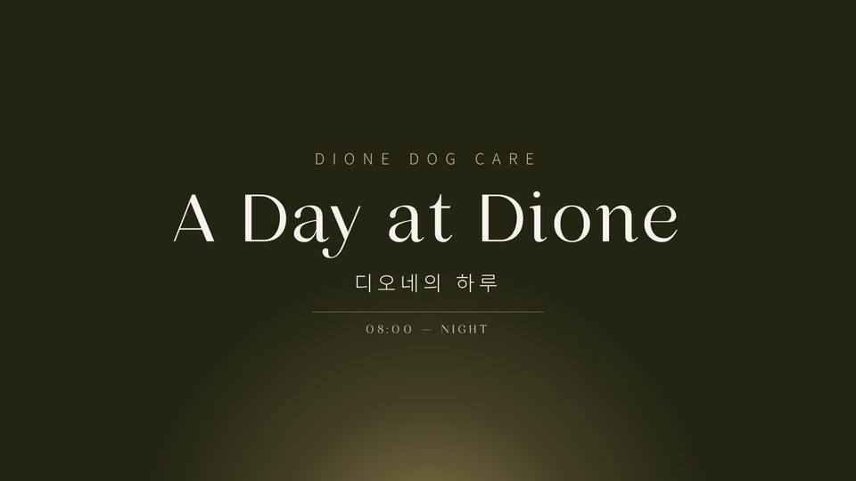 S00 인트로 | 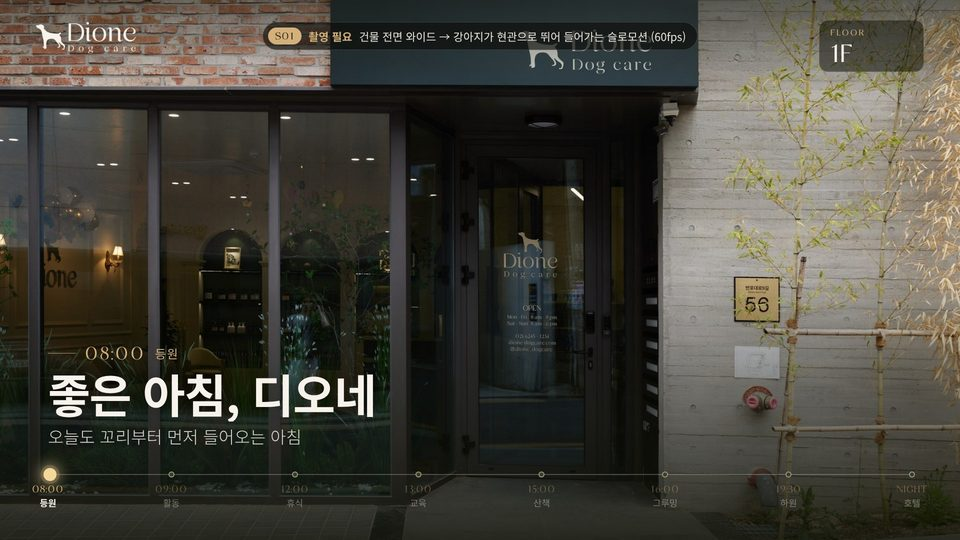 S01 등원 | 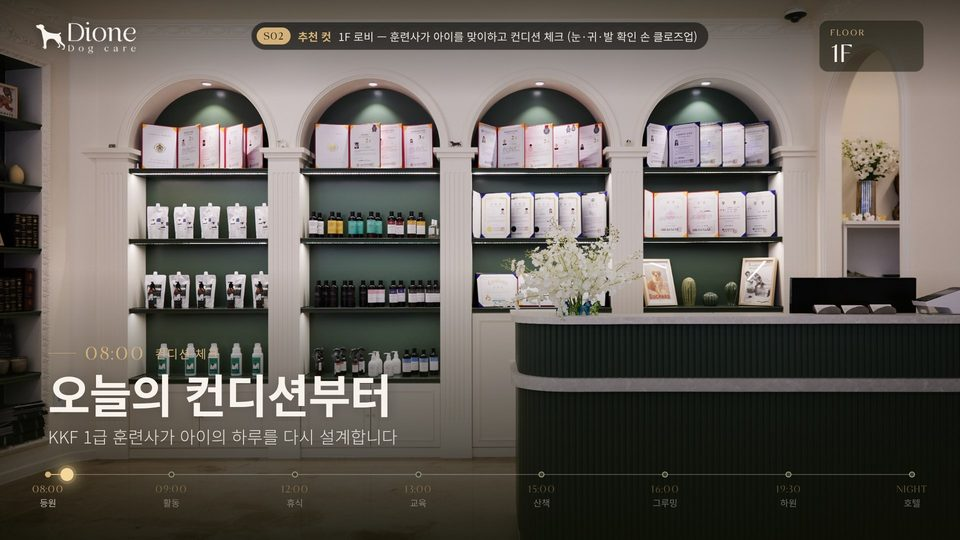 S02 컨디션 체크 |
| 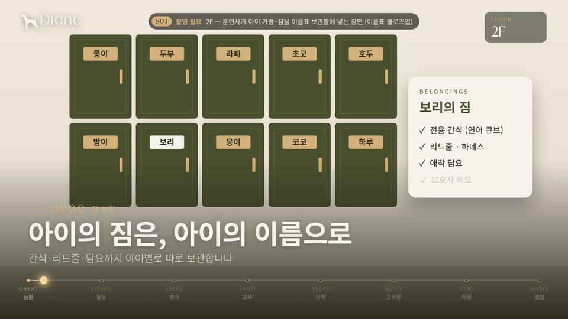 S03 짐 보관 | 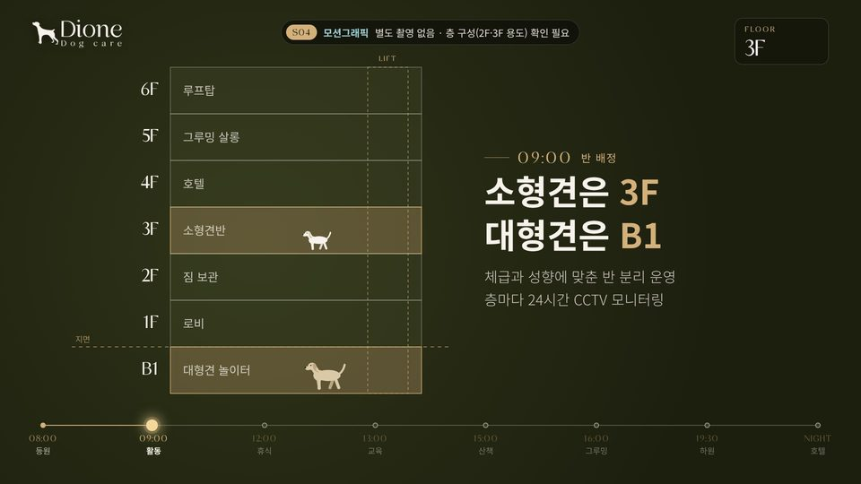 S04 반 배정 | 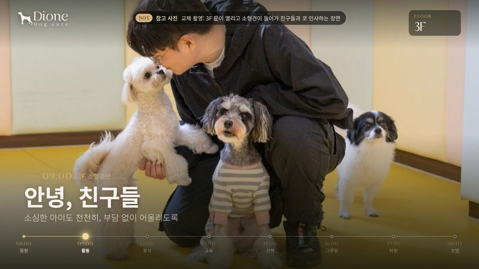 S05 3F 소형견 |
| 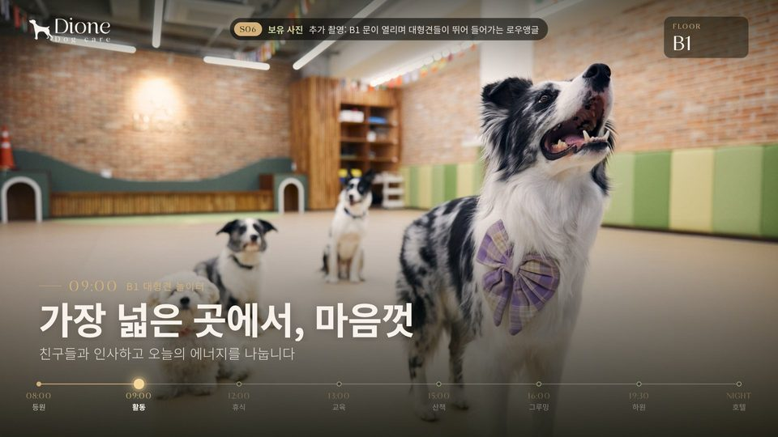 S06 B1 대형견 | 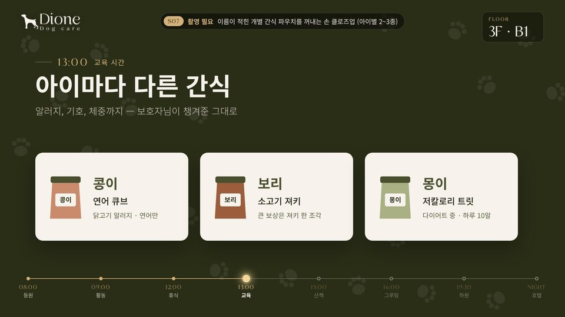 S07 아이별 간식 | 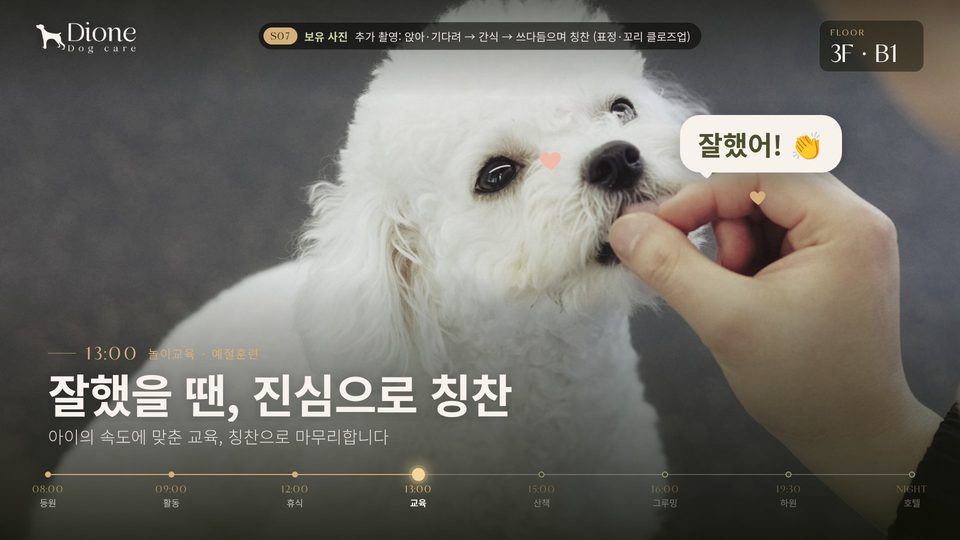 S07 칭찬 |
| 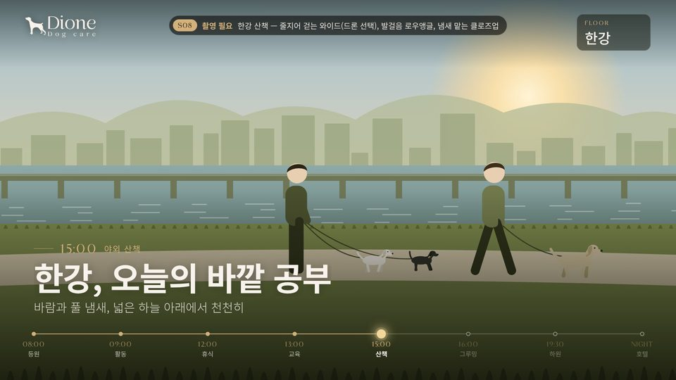 S08 한강 산책 | 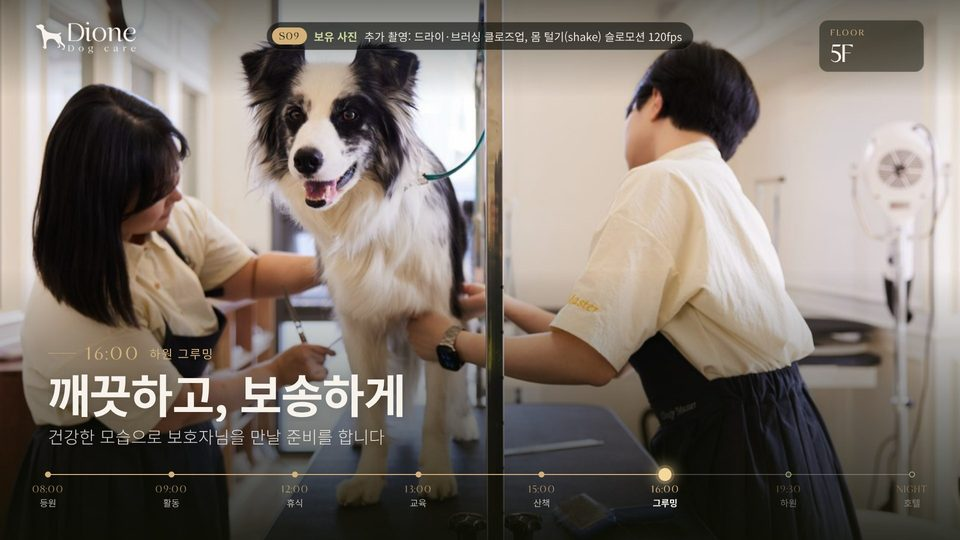 S09 그루밍 | 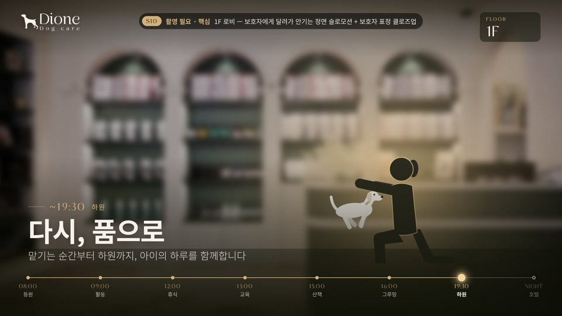 S10 하원 |
| 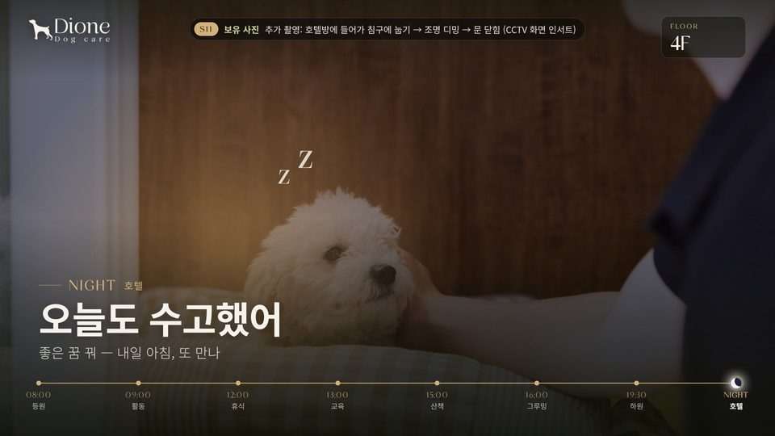 S11 호텔 |  S12 아웃트로 | |

---

## 3. 촬영 리스트 (전달 부탁드리는 영상)

**우선순위:** ★★★ 필수 · ★★ 강력 추천 · ★ 있으면 좋음
**스토리 팁:** 같은 **주인공 강아지** 소형견 1마리와 대형견 1마리를 정해 하루 내내 따라 찍으면, 장면이 하나의 이야기로 이어집니다. (보관함 이름표·간식 파우치 이름도 그 아이 이름으로)

### S01 · 외관 + 등원 ★★★
- [ ] **1-a** 건물 전면 와이드 고정샷(삼각대) — 오전 자연광, 간판·건물번호 보이게, 15초 이상
- [ ] **1-b** 강아지가 프레임 밖에서 달려와 현관으로 뛰어 들어가는 장면 — 문을 열어두고 안에서 훈련사가 이름 부르기. **60fps**(슬로모션용), 3~5테이크
- [ ] **1-c** ★ 현관 안쪽에서 바깥을 보고: 강아지가 카메라 쪽으로 뛰어 들어오는 정면샷

### S02 · 로비 컨디션 체크 ★★ (일과표 08:00과 맞추기 위한 추천 컷)
- [ ] 훈련사가 무릎 꿇고 맞이하는 장면
- [ ] 눈·귀·발바닥 확인하는 **손 클로즈업**, 체크표 작성하는 손(있다면)

### S03 · 2F 짐 보관 ★★★
- [ ] 보호자에게 받은 가방을 들고 2층으로 올라가는 훈련사 뒷모습(계단 또는 엘리베이터)
- [ ] 이름표 붙은 보관함 문을 열고 가방 넣기 — **와이드 1컷 + 이름표 클로즈업 1컷**
- [ ] ★ 가방 속 물품(간식·리드줄·담요) 정리하는 손 인서트
- 소품: 보관함 **이름표** (없다면 제작 추천 — 영상에서 "개별 관리"가 한눈에 보입니다)

### S04 · 층 이동 (모션그래픽) — 촬영 불필요
- [ ] ★ 엘리베이터 층 버튼/표시창 클로즈업, 계단 오르내리는 발 → 그래픽과 섞으면 더 생생합니다

### S05 · 3F 소형견 인사 ★★★
- [ ] 3F 문이 열리고 소형견이 들어가는 장면 (안→밖, 밖→안 두 방향)
- [ ] 친구들과 코 인사, 꼬리 흔드는 **클로즈업**
- [ ] 훈련사가 옆에서 관찰하는 와이드

### S06 · B1 대형견 ★★
- [ ] B1 문이 열리며 대형견들이 뛰어 들어가는 **로우앵글(바닥 높이) 60fps**
- [ ] 친구들과 인사하고 뛰어노는 와이드 (현재 사진으로도 구성 가능)

### S07 · 교육 + 아이별 간식 ★★★
- [ ] 이름 적힌 **개별 간식 파우치/통**에서 간식 꺼내는 손 클로즈업 — 아이 2~3마리, 각각 다른 간식
- [ ] 앉아·기다려 → 간식 → "잘했어!" 하며 쓰다듬는 장면 (훈련사 목소리 **동시녹음** 추천)
- [ ] 칭찬받을 때 강아지 표정·꼬리 클로즈업
- [ ] 예절훈련 / 어질리티 와이드
- 함께 주시면 좋은 정보: 실제로 아이별로 다르게 쓰는 간식 예시(알러지·다이어트 등) → 간식 카드 그래픽에 반영

### S08 · 한강 산책 ★★★
- [ ] 훈련사 + 강아지들이 줄지어 걷는 **측면 와이드** (강·다리 배경)
- [ ] 사람 발 + 강아지 발 **로우앵글** 걸음
- [ ] 풀 냄새 맡는 클로즈업, 바람에 귀가 날리는 슬로모션
- [ ] ★ 드론 버드뷰 — 서울 한강 일대는 대부분 **비행 승인이 필요한 구역**이라 사전에 승인 절차 확인 필요
- 안전: 모든 컷에서 리드줄 착용 (홍보영상 특성상 필수)

### S09 · 하원 그루밍 ★★
- [ ] 드라이·브러싱 클로즈업
- [ ] 목욕 후 **몸 털기(shake) 120fps** 슬로모션 — 가장 반응 좋은 컷
- [ ] 그루밍 끝나고 정면 "짠" 샷

### S10 · 보호자 품으로 ★★★ (영상의 감정 하이라이트)
- [ ] 1F 로비: 보호자가 무릎 꿇고 이름 부르기 → 강아지가 달려와 안기기 — **정면(보호자 뒤에서) + 측면** 두 앵글, 60fps
- [ ] 보호자 표정 클로즈업 (※ **초상권 동의** 필요)
- [ ] ★ 훈련사가 하루 리포트를 전달하며 인사하는 장면

### S11 · 호텔 잠자리 ★★
- [ ] 호텔방 문 열고 들어가 침구에 눕기, 훈련사가 쓰다듬기
- [ ] 조명 디밍 → 문 닫힘
- [ ] 잠든 얼굴 클로즈업
- [ ] ★ CCTV 모니터 / 보호자 앱 화면 인서트 ("방마다 CCTV" 신뢰 포인트)

### (선택) 12:00 개별 휴식 · 낮잠 ★
- 일과표에 있는 12:00 휴식 장면 — 각자 공간에서 쉬는 모습 3초. 넣으면 일과표와 100% 일치합니다.

---

## 4. 촬영 가이드 (스마트폰 촬영도 충분합니다)

| 항목 | 기준 |
|---|---|
| 방향 | **무조건 가로(16:9)** — 세로 영상은 로비 모니터에 못 씁니다 |
| 화질 | 4K 30fps 기본 / 뛰는 장면 **60fps** / 몸 털기 **120fps** |
| 길이 | 컷마다 **최소 10초**, 시작·끝에 2초 여유 (편집 여유분) |
| 높이 | 강아지 눈높이(로우앵글)가 기본 — 무릎 꿇고 찍기 |
| 흔들림 | 짐벌 권장. 없으면 고정샷 위주 + 천천히 걷기 |
| 노출 | 화면 터치로 노출·초점 고정(AE/AF 잠금), 렌즈 닦기 |
| 조명 | 한 장면 안에서 형광등/전구색 섞이지 않게 |
| 전달 | **원본 파일 그대로** (카카오톡 전송은 압축되므로 X) — 구글 드라이브 등으로 |
| 파일명 | `S05_3F인사_01.mov` 처럼 장면번호로 시작하면 편집이 빨라집니다 |
| 촬영 순서 | 실제 하루 일과 순서대로 하루 동안 찍으면 빛·분위기가 자연스럽게 이어집니다 |

## 5. 영상 외에 필요한 자료

- [ ] **로고 원본** (AI / SVG / 배경 투명 PNG) — 현재 `logo.png`는 검은 배경이라 초안에서는 임시로 투명화해서 사용
- [ ] 보관함·간식 카드에 쓸 **실제 아이 이름** 3~10개 (보호자 동의) — 초안은 콩이·보리·몽이 등 가명
- [ ] 마지막 화면에 **카카오톡 상담 QR** 넣을지 여부
- [ ] 배경음악 사용 여부 — 매장 상영이면 상업적 이용 가능한 라이선스 음원 권장 (무음 버전도 함께 제작)

## 6. 확인 부탁드리는 것

1. **층 구성** — 홈페이지는 `2F 유치원 플레이룸(소·중형견) / 3F 디럭스 호텔 / 4F 스위트 호텔`인데, 말씀하신 흐름은 `2F 짐 보관 / 3F 소형견`입니다. 실제 운영 기준을 알려주시면 S04 층 그래픽과 상단 층 표시에 맞추겠습니다. (홈페이지 수정이 필요할 수도 있습니다)
2. **한강 산책 시간** — 홈페이지 일과표의 15:00은 "자유 활동(운동장)"이라 한강 산책이 없습니다. 영상에는 15:00 산책으로 넣었는데, 실제 시간과 일과표 반영 여부를 알려주세요.
3. **호텔 장면 층** — 3F 디럭스 / 4F 스위트 중 어디로 할지 (초안은 4F 스위트)
4. **모니터 사양** — 가로/세로, 해상도(FHD/4K), 소리 켜는지
5. **길이** — 로비용 약 90~100초 + 홈페이지·인스타용 30초 / 15초 버전도 필요한지

---

## 파일 구성 / 다시 렌더링하기

```
promo-video/
├─ README.md                  ← 이 문서 (기획안 · 촬영 리스트)
├─ dione-a-day-draft.mp4      ← 초안 영상 (촬영 메모 포함)
├─ storyboard/                ← 장면별 스틸
└─ draft/
   ├─ animatic.html           ← 초안 영상 원본 (브라우저로 열면 재생·스크럽 가능)
   ├─ render.mjs              ← 렌더러 (Playwright + ffmpeg)
   ├─ assets/logo-cream.png   ← 투명 크림색 로고 (임시)
   └─ fonts/                  ← Noto Sans KR (영상에 쓰인 글자만 포함한 경량본)
```

```bash
# 저장소 루트에서
node promo-video/draft/render.mjs            # 촬영 메모 포함 초안
node promo-video/draft/render.mjs --clean    # 촬영 메모 없는 버전
node promo-video/draft/render.mjs --stills 9,48,75   # 특정 시점 스틸만
```

`animatic.html`을 파일로 바로 열면 브라우저 보안 정책 때문에 폰트가 빠질 수 있으니, 저장소 루트에서 `python3 -m http.server` 실행 후 `http://localhost:8000/promo-video/draft/animatic.html`로 여는 것을 권장합니다 (재생 버튼·스크럽바·촬영 메모 숨기기 포함).
※ `fonts/`는 영상에 쓰인 글자만 남긴 경량본이라, 자막에 새 글자를 넣으면 Noto Sans KR 원본으로 바꾸거나 서브셋을 다시 만들어야 합니다.

실제 영상을 받으면 장면별로 ``를 `<video>`로 교체해 같은 모션그래픽 위에 얹는 방식으로 최종본을 만듭니다.
